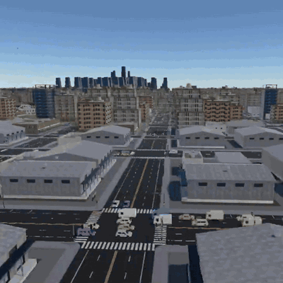
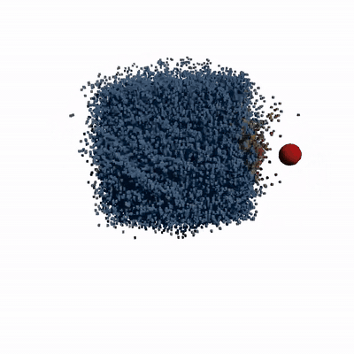
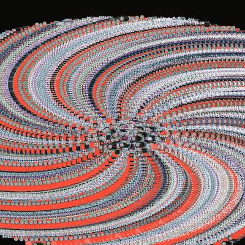

# SPITE showcases

Four source-built showcases share one SPITE SDK project: Warzone, CityShowcase, FormationsShowcase, and UiStorm. Each has its own module and scene. Install SPITE SDK 0.2.7, a Vulkan-capable GPU and driver, Python, CMake, Ninja and a compatible C++ toolchain; `spite doctor` checks the setup.

| [CityShowcase](src/CityShowcase/) | [FormationsShowcase](src/FormationsShowcase/) | [UI Storm](src/UiStorm/) |
| --- | --- | --- |
|  |  |  |

Download `spite-showcases-assets-0.1.0.zip` and `SHA256SUMS.txt` from the repository's v0.1.0 release. Verify the SHA-256, create `assets_baked` at the repository root, and extract the zip's contents into that folder, preserving its directory structure.

From the repository root run `spite build`. Launch one showcase at a time with `python run_showcase.py warzone`, `city`, `formations`, or `ui`. The launcher selects the module and opens its scene in the editor; for Warzone it also installs the audio files from the archive into `assets/audio`. Start Play and focus the Game panel. Close the editor before launching another showcase. Plain `spite run` loads all modules and starts an empty scene.

Warzone: 1–4 select tank, AMP, helicopter or jet; WASD moves, mouse aims, left mouse or F fires, right mouse uses sights, scroll zooms, H toggles the HUD, M starts a match and Tab shows its scoreboard. O or F10 opens the settings and battle menus. GIGA mode is enabled in the battle menu: Space jumps, F throws the truth nuke, G grabs and T throws. See [Warzone](src/Warzone/README.md) for menu navigation.

City has a toolbar for simulation speed, pause and inspection. Formations runs its simulation in Play. UI Storm's toolbar changes patterns and styles, shuffles, pauses and rebuilds widgets. See the individual folders for details.

After building, run `build/WarzoneTests.exe` from the repository root and `build/CityDesignTests.exe` with the SDK `bin` folder on PATH. Code is MIT licensed; asset terms are described in [ASSETS-LICENSE.md](ASSETS-LICENSE.md).
