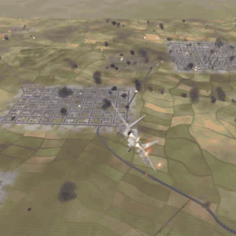

# Warzone

A vehicle battle across destructible towns, with AI opponents, tank, AMP, helicopter and jet. From the repository root run `python run_showcase.py warzone`, start Play and focus Game.

1–4 select a vehicle; WASD moves, mouse aims, left mouse or F fires, right mouse uses sights and scroll zooms. H toggles the HUD; M starts a match and Tab shows the scoreboard. In the spawn screen choose a vehicle with 1–4, a spawn point with A/D and deploy with Space or F.

O or F10 opens settings, scene and battle menus. Navigate with arrow keys and Enter, change tabs with Page Up/Page Down, and close with Backspace. Enable GIGA in the battle menu: Space jumps, F throws the truth nuke, G grabs and T throws.
